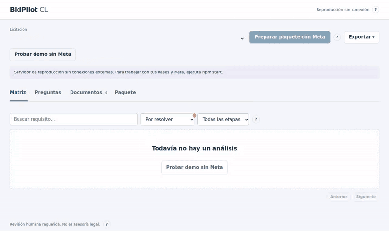

# BidPilot CL

Agente local-first que prepara postulaciones a licitaciones de [Mercado Público](https://www.mercadopublico.cl) (Chile).
Lee las bases, extrae los requisitos **con su cita literal**, los contrasta con la evidencia del proveedor y deja un paquete auditable para revisión humana.



## Pruébalo sin claves

```bash
npm ci && npm run demo   # Node.js 24
```

Abre http://127.0.0.1:3000 y pulsa **Probar demo sin Meta**. Usa bases y evidencia ficticias
con resultados de reproducción: no llama a APIs externas. [Guion de la demo](docs/DEMO.md).

## Decisiones de diseño

- **Límite agente/código.** El controlador decide fases, precondiciones, rutas y escrituras;
  el modelo solo extrae y clasifica dentro de esquemas JSON estrictos (Zod). Lo que no valida
  se rechaza. Qué preguntar al usuario, en qué orden y cuándo pausar lo decide el código.
  [Flujo del agente](docs/AGENT_WORKFLOW.md).
- **Citas verificadas.** Cada requisito lleva página física y cita, que se comprueba
  literalmente contra el texto del PDF; si no aparece, el requisito no se acepta.
  [Extracción](docs/EXTRACTION_NOTES.md) · [Matriz](docs/MATRIX_NOTES.md).
- **Checkpoints reanudables.** Extracción y matriz se procesan por bloques guardados con
  hash de sus entradas: un reinicio o un fallo de red retoma desde el último bloque válido
  sin repetir llamadas ni duplicar resultados. Reintentos con backoff y `retry-after`.
- **Evals con etiquetas propias.** Dos licitaciones históricas etiquetadas a mano, con
  revisiones congeladas por hash para medir cada versión del prompt (p. ej. 31/34 requisitos
  recuperados). [Evaluación](eval/README.md).
- **Local-first y trazable.** Los datos quedan en `data/`; la exportación incluye manifiesto
  con hashes de cada artefacto y original. Nunca envía nada al portal.

## Desarrollo

```bash
npm run check            # typecheck + ESLint + Prettier + tests (Vitest)
npm run demo:rehearse    # 3 recorridos completos de la demo (requiere agent-browser)
```

Modo real con Meta y Mercado Público, CLI, métricas y Docker: [uso avanzado](docs/USO_AVANZADO.md).

```
packages/core   agente, herramientas, checkpoints, esquemas y paquete
packages/web    interfaz local servida en localhost
eval/           etiquetas, revisiones y resultados de evaluación
docs/           notas técnicas
```

**No es asesoría legal.** Revisa siempre las bases originales antes de postular.
Parte del código se escribió con ayuda de [Claude Code](https://claude.com/claude-code). Licencia [MIT](LICENSE).
